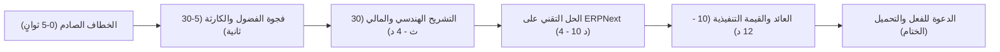

# دستور ومعايير الإنتاج المرئي الفائق (Master Video Production & Prompt Framework)
## المرجع القياسي لقناة "الذكاء المؤسسي" (Enterprise Intelligence)

---

### الرؤية والهدف الاستراتيجي
تأسيس معيار إنتاج سينمائي وهندسي وتنفيذي من الطراز الأول عالمياً، يجمع بين **دقة بيوت الخبرة العالمية (McKinsey / Big 4)** و**إبهار الإنتاج السينمائي والوثائقي (Netflix / Bloomberg Originals)**. كل ثانية، وكل كادر، وكل كلمة مصممة لتحقيق أقصى درجات المشاهدة، وتوليد صدمة معرفية، وبناء ثقة مطلقة لدى القيادات التنفيذية والخبراء.

---

## 1. دستور السرد وهندسة الانتباه (Narrative & Retention Engineering)

لتحقيق مليارات المشاهدات واكتساح خوارزميات المنصات (يوتيوب، لينكد إن، إكس، تيك توك)، يخضع كل فيديو لقاعدة **"النبض المتصاعد" (The Escalating Pulse)**:



### معايير التوقيت المشددة:
* **الثواني الخمس الأولى (The 5-Second Brutal Hook):**
  * ممنوع المقدمات الترحيبية ("أهلاً بكم في القناة").
  * البدء فوراً بحدث صادم: رقم مالي ضخم، تصدع مبنى، كارثة نظامية، أو سؤال يهدد منصب المدير.
* **إيقاع التبديل البصري (Visual Pacing):**
  * تغيير زاوية الكاميرا أو إدخال عنصر بصري (B-Roll, Graphic, Motion) كل **3 إلى 5 ثوانٍ كحد أقصى** لمنع تشتت عين المشاهد.
* **مبدأ "أرني ولا تخبرني فقط" (Show, Don't Just Tell):**
  * عند ذكر "خسارة 10 ملايين دولار"، يظهر رسم بياني ينحدر للهاوية مع صوت إنذار خافت.
  * عند ذكر "خطأ في الخرسانة"، يظهر كود الـ ERP مع تقرير فحص الموقع ومخطط ثلاثي الأبعاد.

---

## 2. مصفوفة التكامل الرباعي (The 4-Pillar Integration Standard)
لا يجوز إطلاق أي حلقة أو فيديو دون تضمين أركان المنظومة المؤسسية الأربعة:

| الركن | المتطلب القياسي في المحتوى | أسلوب الظهور المرئي |
| :--- | :--- | :--- |
| **1. الهندسة (مدني / معماري)** | دقة مصطلحات المشاريع، الـ BOQ، الكودات الإنشائية، عقود الفيديك (FIDIC)، والمخططات. | لقطات درون لمشاريع عملاقة، مخططات BIM ثلاثية الأبعاد، تراكب رسومي على الموقع. |
| **2. الأنظمة والبرمجة (ERPNext / Frappe)** | الشرح التقني المعياري (DocTypes, Workflows, APIs, Server/Client Scripts) دون تعقيد غير مفهوم. | تسجيل شاشة عالي النقاء (4K UI) مع زووم سينمائي على الحقول البرمجية المؤتمتة. |
| **3. المالية والمحاسبة (Financial Governance)** | أثر كل حركة على ميزان المراجعة، شجرة الحسابات، مراكز التكلفة، والتدفق النقدي (Cash Flow). | شاشات تداول ورسوم بيانية متحركة، إبراز القيود المحاسبية الدائنة والمدينة بانسيابية. |
| **4. القيادة التنفيذية (C-Suite Impact)** | الإجابة عن سؤال: "ما هو الأثر على الأرباح، تقليل المخاطر، وقيمة الشركة السوقية؟" | لوحات تحكم تفاعلية (Interactive Executive Dashboards) تعرض مؤشرات الأداء (KPIs). |

---

## 3. المعيار القياسي لتوليد برومبتات الفيديو والذكاء الاصطناعي (AI Prompt Formula)

عند توليد أي برومبت للمشاهد المرئية (الموجهة لأدوات الذكاء الاصطناعي السينمائي مثل Sora, Runway Gen-3, Midjourney, Kling, Flux)، يُطبق البناء القياسي الموحد التالي:

```
[Camera & Shot Type] + [Subject & Action] + [Environment & Architectural Lighting] + [Technical & Material Details] + [Mood & Atmosphere] + [Cinematic Parameters]
```

### القواعد الفنية الملزمة للبرومبتات:
1. **العدسات والإضاءة (Cinematic Lighting):**
   * استخدام مصطلحات الإخراج الاحترافي: `Anamorphic lens`, `Photorealistic 8K`, `Corporate Volumetric Lighting`, `Subtle Depth of Field`, `Clean Minimalist Architectural Tone`.
2. **البيئات (Environments):**
   * تجنب العشوائية. تحديد بيئات فاخرة وواقعية:
     * *صالات مجالس إدارة ناطحات السحاب (Glass high-rise boardroom overlooking Dubai/Singapore/New York).*
     * *مواقع إنشائية ضخمة بتقنيات متقدمة (Hyper-realistic mega-construction site with tower cranes at sunset).*
     * *غرف تحكم بيانات وأنظمة حديثة (Sleek minimalist enterprise data center with subtle ambient blue-orange lights).*
3. **الألوان والـ Grading:**
   * الحفاظ على هوية بصرية تجمع بين:
     * **الأزرق السيبراني العميق (Enterprise Blue)** لتمثيل الاستقرار والتقنية.
     * **البرتقالي الإنشائي / الذهبي المالي (Safety Orange & Gold)** لتمثيل الحركة والربحية.
     * **الرمادي المعماري الأنيق (Architectural Concrete Grey)** لتمثيل الرصانة الإنشائية.

---

## 4. نموذج توليد السكريبت والبرومبت المدمج (Master Video Blueprint Template)

هذا هو القالب المرجعي المعتمد لكل حلقة جديدة:

```markdown
### معلومات الحلقة
* **عنوان الحلقة (Click-Rate Optimized):** [عنوان صادم ومثير للجدل ويعد بحل استثنائي]
* **الفئة المستهدفة الرئيسية:** [CEO / CFO / مهندسون / مبرمجون / الجميع]
* **المشكلة الجوهرية (The Pain Point):** [الخطأ الذي يسبب خسارة فادحة]
* **الحل المؤسسي (The Antidote):** [تطبيق الميزة في ERPNext وربطها بالعمليات]

---

### جدول المشاهد وسيناريو التنفيذ (Scene-by-Scene Breakdown)

#### المشهد [01]: الخطاف (The Hook) | [00:00 - 00:08]
* **السرد الصوتي (Voiceover Script):**
  > "..."
* **التوجيه البصري (Visual Direction):**
  * حركة الكاميرا: [مثلاً: Zoom-in سريع نحو شاشة لوحة تحكم تضيء بالأحمر]
* **برومبت توليد المشهد (AI Video Prompt):**
  `Cinematic 8K, extreme close-up of a luxury boardroom table, high-end curved monitor displaying financial charts plummeting in red neon, dramatic volumetric lighting, shallow depth of field, anamorphic style, 24fps.`
* **المؤثرات الصوتية والموسيقية (Audio/SFX):** [صوت دقات ساعة سريعة متبوعة بإنذار عميق]

#### المشهد [02]: تشريح الخطأ الإنشائي/المالي | [00:08 - 00:45]
... [تكرار الهيكلية لكل مشهد بدقة ثوانٍ وحركات الكاميرا والبرومبت]

#### المشهد [03]: التطبيق العملي على ERPNext | [الشرح والبرمجة والأتمتة]
...
```

---

## 5. بوابة فحص الجودة الصارمة (Zero-Error Quality Gate)

قبل اعتماد أي حلقة للنشر، يجب أن تجتاز الفحوصات الخمسة التالية:
1. **فحص الدقة المحاسبية:** هل تتطابق القيود مع معايير IFRS/GAAP؟ (لا يمكن التسامح مع قيد غير متوازن).
2. **فحص الواقعية الهندسية:** هل بنود الـ BOQ وأوامر التغيير ونسب الهدر مطابقة لما يحدث في المواقع الحقيقية؟
3. **فحص كود ومعمارية ERPNext:** هل الكود البرمجي المكتوب يتبع معايير Frappe Framework ولا يكسر التحديثات المستقبلية؟
4. **فحص القيمة الاستشارية:** هل خرج المشاهد بحل يستطيع تطبيقه غداً في شركته ووفر عليه آلاف الدولارات؟
5. **فحص الجاذبية البصرية (Visual Magnetism):** هل الفيديو ممتع بصرياً ويضاهي وثائقيات القنوات التلفزيونية العالمية؟

---

## 6. المعيار المعتمد لدقة وأبعاد وأحجام الفيديوهات (Official Video Specs Standard)

بناءً على التوجيه القيادي المعتمد للقناة، تخضع جميع مخرجات الحلقات الوثائقية الطويلة للمعايير التالية:
* **الأبعاد:** 16:9 أفقية سينمائية (Horizontal Widescreen).
* **الدقة المعتمدة:** **720p HD (1280x720)** — توفر الوضوح السينمائي التام مع سلاسة البث وسرعة التحميل الفائقة للمستخدمين.
* **الحجم ومعدل الضغط:** نظام الضغط عالي الكفاءة (`H.264 CRF=25`, `AAC 128kbps`) ليكون حجم الحلقة الكاملة (4 دقائق) في حدود **25 إلى 30 ميجابايت كحد أقصى** لسهولة الرفع والمشاركة الفورية.
* **أسلوب معالجة اللقطات (Cinematic Ambient Fill):** عند معالجة لقطات مولدة ذات اتساع رأسي، تُطبق تقنية التوسيع الإذاعي السينمائي بملء جوانب الكادر بتمويه ضوئي متناغم (`Ambient Blur Fill`) لمنع الأشرطة السوداء الميتة والحفاظ على هيبة المشهد 16:9.

---

> **اعتماد هذا الدستور:** يُعتبر هذا الملف مرجعاً تأسيسياً دائماً ومقيداً لجميع المخرجات، البرومبتات، وحزم المحتوى الصادرة للقناة عبر جميع المنصات.
