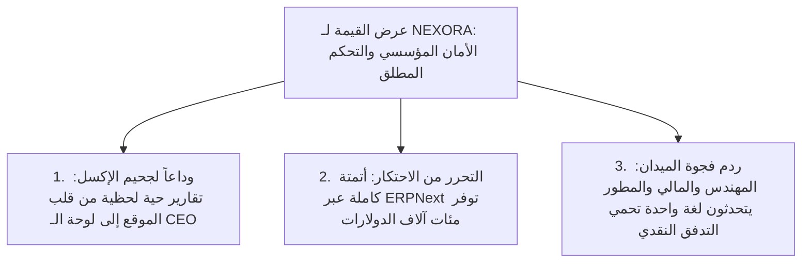
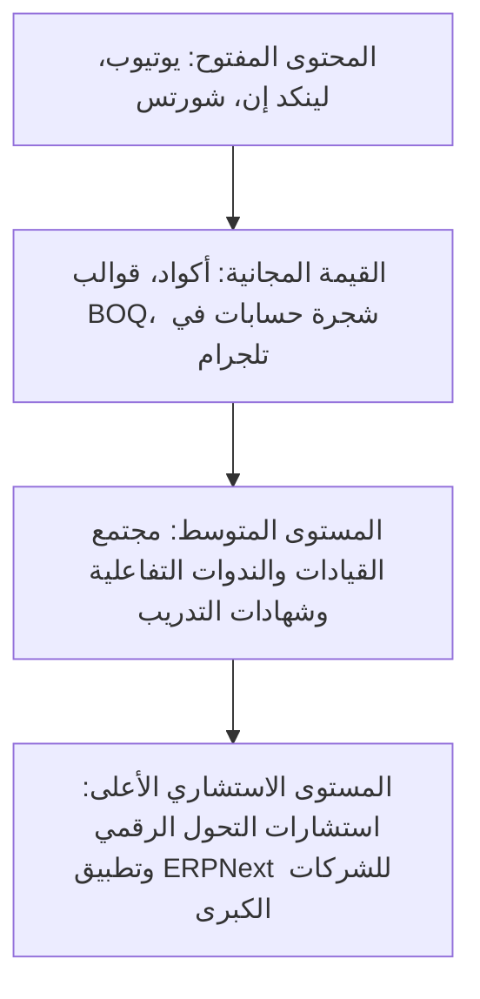

# NEXORA — PHASE 02 — STRATEGY, POSITIONING & BRAND IDENTITY
## المرحلة 02: الاستراتيجية، التموضع المؤسسي، والهوية التجارية

---

### 1. رقم المرحلة واسمها
* **المرحلة:** 02 (Phase 02)
* **الاسم:** الاستراتيجية التنافسية، التموضع المؤسسي، وهيكلية الهوية التجارية (Strategy, Positioning & Brand Identity).

---

### 2. الهدف من المرحلة (Objective)
تحديد وتثبيت البوصلة الاستراتيجية الكاملة لـ **NEXORA**، بما يشمل:
1. صياغة التموضع الذهني الفريد (Mental Positioning) الذي يجعل المنصة لا تُقارن بأي صانع محتوى تقليدي.
2. بناء عرض القيمة الفريدة (Unique Value Proposition - UVP) الموجّه للشركات وقادة الأعمال.
3. تحديد نبرة الصوت وشخصية البراند (Brand Persona & Tone of Voice) لضمان الهيبة الاستشارية.
4. رسم معمارية الرسائل الموجهة لكل شريحة من الجماهير الأربعة (C-Suite, Finance, Engineering, Developers).

---

### 3. نطاق العمل (Scope of Work)
* **التموضع التنافسي:** تحويل NEXORA من مجرد "قناة يوتيوب" إلى **"بيت خبرة ومرجع معرفي رقمي رائد (Digital Advisory Institution)"**.
* **معمارية العلامة التجارية:** الهوية المشتركة `NEXORA — الذكاء المؤسسي` وربطها بالحلول التطبيقية المفتوحة المصدر (ERPNext).
* **لغة الخطاب:** خطاب تنفيذي باللغة العربية الفصحى الراقية مع دمج المصطلحات التقنية والمالية الدولية بالإنجليزية (Bilingual Executive Fluency).

---

### 4. منهجية التموضع وبناء الهوية (Methodology)
* **نموذج التموضع الكلاسيكي (Kotler & Keller Positioning Framework):**
  * *الفئة المرجعية (Category):* الذكاء المؤسسي والتحول الرقمي لإدارة العمليات والمشاريع.
  * *نقاط التشابه (Points of Parity - POP):* جودة الصورة، سهولة الفهم، والانتشار عبر السوشيال ميديا.
  * *نقاط الاختلاف الجوهرية (Points of Difference - POD):* الربط الحصري بين الموقع الإنشائي والدفتر المالي وكود ERPNext التطبيقي.
* **نموذج شخصيات يونغ للأعمال (Archetypes in Branding):**
  * شخصية NEXORA المزدوجة: **"الحكيم المستشار (The Sage)"** ممزوجاً بـ **"الحاكم البنّاء (The Ruler / Creator)"**؛ قوة المعرفة المقترنة بالقدرة على تشييد إمبراطوريات تجارية وهندسية.

---

### 5. النتائج التفصيلية (Detailed Findings)

#### أ. التموضع الاستراتيجي (Strategic Positioning Statement)
> **"لكل رئيس تنفيذي، مدير مالي، ومهندس طموح يسعى لحماية شركته من نزيف المشاريع والقرارات العمياء؛ NEXORA هي بيت الخبرة الرقمي الأول عالمياً الذي يكشف خفايا كوارث الشركات بالأرقام، ويمنحك شفرة الحوكمة وأتمتة العمليات عبر أنظمة ERPNext المفتوحة المصدر، لأننا نؤمن أن الأرباح الحقيقية تُصنع عند التقاء لغة الهندسة بدقة المحاسبة ومنطق البرمجة."**

#### ب. عرض القيمة الفريدة (Unique Value Proposition - UVP)



#### ج. شخصية العلامة ونبرة الصوت (Brand Persona & Tone of Voice)

| الملمح | كيف تتحدث NEXORA؟ | ما الذي تتجنبه NEXORA تماماً؟ |
| :--- | :--- | :--- |
| **المستوى والمكانة** | استشاري دولي رفيع المستوى، يمتلك ثقة كبار الشركاء في McKinsey وPwC. | المبتدئ المتردد، أو "اليوتيوبر" التقليدي الذي يستجدي الإعجابات والمتابعات. |
| **النبرة الصوتية** | حازمة، هادئة، دقيقة، عميقة، ممتلئة بالخبرة والمصداقية، خالية من التكلف. | الصراخ، الحماس المفتعل، النبرة الوعظية الفارغة من الأدلة. |
| **طبيعة الطرح** | تشريح بالوثائق، الأرقام، المخططات، شاشات الأنظمة الحية، وسرد كوارث واقعية. | الوعود الوردية الزائفة، التبسيط المخل بالحقائق الهندسية والمالية. |
| **المصطلحات** | مزيج احترافي يضع المصطلح بالعربية الفصحى مع رديفه الدولي (BOQ, ERP, GL, Change Order). | التعريب المشوه للمصطلحات البرمجية أو استخدام لغة أجنبية دون داعٍ. |

---

### 6. معمارية الرسائل الموجهة للشرائح الأربع (Audience Messaging Matrix)

```mermaid
graph LR
    NEXORA[NEXORA | الذكاء المؤسسي] --> CSuite[1. الرؤساء التنفيذيون CEOs]
    NEXORA --> CFO[2. المدراء الماليون CFOs]
    NEXORA --> Engineers[3. المهندسون والمشاريع]
    NEXORA --> Tech[4. المبرمجون والـ CTOs]

    CSuite --> M1["الرسالة: سيطرة كاملة على النزيف المالي وقرارات مدعومة بلوحات تحكم حية"]
    CFO --> M2["الرسالة: وداعاً للأرباح الوهمية؛ كل حركة مخزن وموقع تنشئ قيداً محاسبياً دقيقاً"]
    Engineers --> M3["الرسالة: حوّل حصر الكميات والمخططات إلى مستخلصات غير قابلة للطعن أو الرفض"]
    Tech --> M4["الرسالة: ارتقِ من مجرد كاتب كود إلى مهندس معمارية حلول مؤسسية بملايين"]
```

#### صياغة الرسائل التفصيلية:
1. **رسالة الرؤساء التنفيذيين (CEOs):**
   * *"لا تدع شركتك تدار ببيانات الشهر الماضي. NEXORA تمنحك الرادار التنفيذي الذي يكشف الأخطاء قبل حدوثها ويحرر منظمتك من تكاليف الأنظمة المغلقة الباهظة."*
2. **رسالة المدراء الماليين (CFOs):**
   * *"الأرباح على الورق لا تدفع رواتب الموظفين. نعلمك كيف تقيد حركة كل كيس إسمنت وساعة تشغيل معدة في ميزان المراجعة لحظياً عبر ERPNext دون فجوات."*
3. **رسالة المهندسين (Civil & Architects):**
   * *"قيمتك المهنية تتضاعف عندما تفهم كيف يتحول جدول الـ BOQ والمخطط إلى تدفقات مالية معتمدة. لا تكن ضحية لتأخر المستخلصات بعد اليوم."*
4. **رسالة المطورين والـ CTOs:**
   * *"توقف عن إعادة بناء العجلة بمشاريع Full-stack تموت بعد عامين. تعلم معمارية Frappe Framework وكن المعماري الذي تتقاتل عليه كبرى المؤسسات."*

---

### 7. ركائز المحتوى الاستراتيجي (Strategic Content Pillars)

لتطبيق هذا التموضع على أرض الواقع، تم توزيع المحتوى على 4 أعمدة رئيسية:

1. **العمود 1: تشريح الكوارث والتحقيقات المؤسسية (Enterprise Autopsy - 35%):**
   * دراسات حالة وثائقية سينمائية تفكك أسباب إفلاس أو تعثر المشاريع العملاقة بأدلة مالية وهندسية.
2. **العمود 2: ماستر كلاس الحلول البرمجية عبر ERPNext (Technical Blueprint - 30%):**
   * جلسات تطبيقية مباشرة على شاشة النظام مع توفير أكواد الأتمتة (Frappe Scripts) مجاناً.
3. **العمود 3: مناظرات ومقارنات "الصح والخطأ" (Right vs. Wrong Arena - 20%):**
   * كشف الممارسات القاتلة في إدارة الموازنات، المستخلصات، سلاسل الإمداد، وتوجيه الشركات للطريقة المعيارية.
4. **العمود 4: كبسولات القيادة والتحول الرقمي (Executive Briefs - 15%):**
   * نصائح سريعة ومكثفة لصناع القرار حول اختيار الأنظمة، قياس إنتاجية الفرق، وإدارة التغيير.

---

### 8. نموذج أعمال وقمع الخدمات المؤسسية (B2B Enterprise Funnel)

NEXORA ليست مجرد منصة إعلانات AdSense، بل هي **قمع استشاري عالي القيمة (High-Ticket B2B Funnel)**:



---

### 9. القرارات والتوصيات الصادرة عن المرحلة 02

* **القرار الاستراتيجي 1:** إرساء التموضع كـ **"المرجع المعرفي للذكاء المؤسسي"** وليس مجرد شروحات برمجية سطحية.
* **القرار الاستراتيجي 2:** اعتماد أسلوب الحوار العقلاني المستند إلى الأرقام والـ Business Logic مع تقديم الكود والملفات التطبيقية مجاناً لبناء ولاء أعمى لدى الجمهور المتخصص.
* **القرار الاستراتيجي 3:** مواءمة جميع منصات النشر الأربع (يوتيوب، لينكد إن، تلجرام، واتساب) لتعمل كأوركسترا واحدة تصب في خدمة هذا التموضع.

---

### 10. النقاط التي تحتاج إلى اعتماد المالك (Gate 02 Sign-off)

1. **اعتماد بيان التموضع الاستراتيجي وعرض القيمة الفريدة (UVP).**
2. **اعتماد نبرة الصوت وشخصية البراند المستشارة (The Sage / The Builder).**
3. **اعتماد الأعمدة التحريرية الأربعة للمحتوى وقمع الخدمات المؤسسية.**
4. **منح الإذن بالانتقال إلى: المرحلة 03 (الهوية البصرية ودليل الاستخدام).**

---

### 11. حالة المرحلة (Phase Status)
* **الحالة:** `مكتملة للمراجعة والاعتماد (Completed for Sign-off)`
* **المرحلة التالية فور الاعتماد:** الانتقال إلى المرحلة 03 وإعداد مستند:
  `NEXORA — PHASE 03 — VISUAL IDENTITY & BRAND GUIDELINES`
