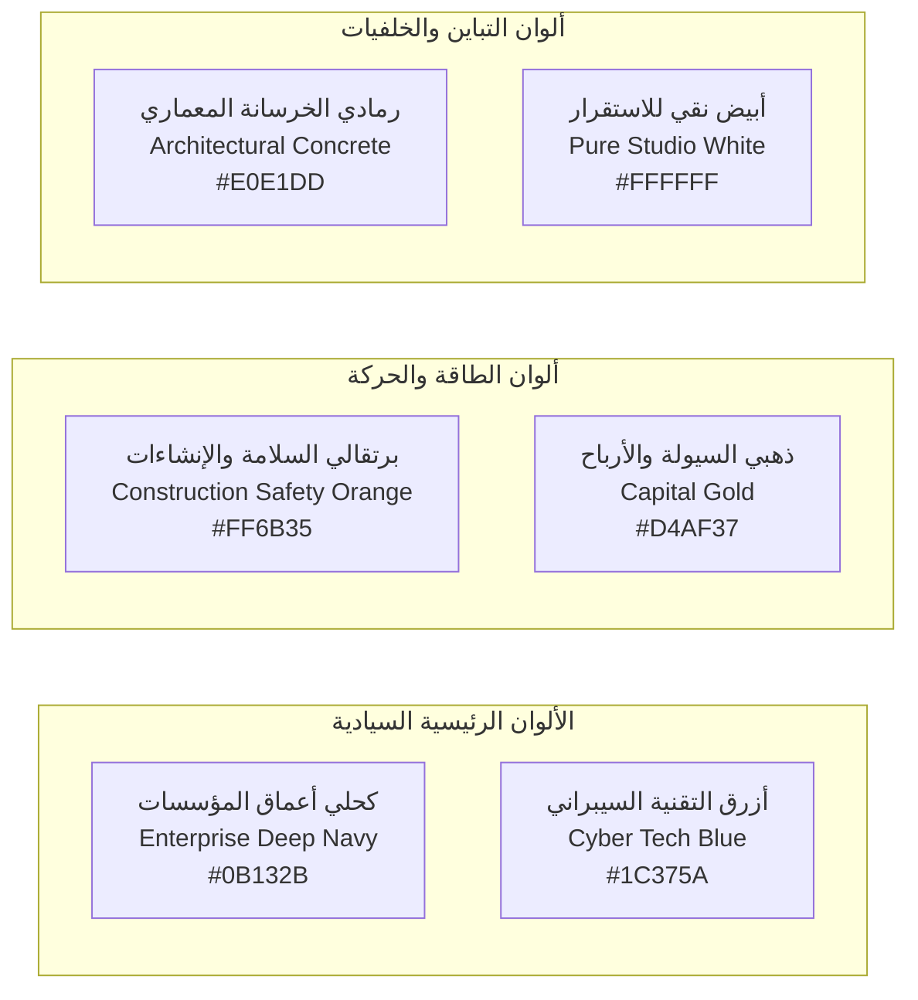

# NEXORA — PHASE 03 — VISUAL IDENTITY & BRAND GUIDELINES
## المرحلة 03: الهوية البصرية ودليل الاستخدام والتصميم المؤسسي

---

### 1. رقم المرحلة واسمها
* **المرحلة:** 03 (Phase 03)
* **الاسم:** نظام الهوية البصرية، فلسفة التصميم، ودليل الاستخدام القياسي (Visual Identity & Brand Guidelines).

---

### 2. الهدف من المرحلة (Objective)
تأسيس نظام بصري عالمي صارم (Design System) يعكس هيبة ومصداقية كبرى المؤسسات المالية والاستشارية (مثل Bloomberg, McKinsey, Financial Times)، ويضمن:
1. تمييز محتوى **NEXORA** بمجرد مرور عين المشاهد على الغلاف أو الفيديو في أقل من نصف ثانية.
2. توحيد الألوان، الخطوط، التراكيب الرسومية (Motion Graphics)، وشاشات العرض عبر كافة المنصات.
3. توفير معايير تصميم محددة بدقة (Hex Codes, Typography, Grids, Safe Zones) تمنع العشوائية البصرية في الإنتاج المستقبلي.

---

### 3. نطاق العمل (Scope of Work)
* **الشعار والأيقونة المؤسسية:** فلسفة الشعار، المساحات الآمنة، واستخدامات الأيقونة.
* **لوحة الألوان القياسية (Color Palette):** الألوان الأساسية، الثانوية، والوظيفية مع رموزها الرقمية.
* **الهندسة الطباعية والخطوط (Typography):** الخطوط العربية والإنجليزية المعتمدة للعناوين والمتون والبيانات.
* **نظام الأغلفة والصور المصغرة (Thumbnail Grid & Hierarchy):** هيكل توزيع العناصر البصرية والنصوص.
* **المعايير السينمائية ومونتاج الفيديو (Cinematic LUTs & Motion Standards):** تدرج الألوان، الإضاءة، وحركة الرسوم البيانية.

---

### 4. فلسفة التصميم والمنهجية (Design Philosophy)
* **الفلسفة:** **"الدقة الهندسية والوقار المالي" (Architectural Precision & Financial Gravity)**.
* نبتعد تماماً عن الألوان الطفولية الفاقعة أو التصاميم المزدحمة بأسلوب "اليوتيوبرز الترفيهيين".
* نعتمد على:
  * المساحات السلبية النظيفة (Negative Space).
  * التباين العالي المدروس (High Functional Contrast).
  * التراكيب ثلاثية الأبعاد الواقعية (Photorealistic 3D & Isometric Architectural Layouts).

---

### 5. النتائج التفصيلية (Detailed Findings & Guidelines)

#### أ. فلسفة الشعار والأيقونة (Logo & Mark Concept)
* **الرمز الأيقوني (The Mark):**
  * شكل هندسي يدمج بين **(مخطط معماري متقاطع + عقدة شبكية رقمية + سهم تدفق صاعد)**. يرمز إلى نقطة التقاء (Nexus) العمليات الميدانية بالأنظمة والنمو المالي.
* **التكوين النصي (The Wordmark):**
  * كلمة **NEXORA** بحروف لاتينية عريضة ورصينة (Geometric Sans-serif) مع تفريغ هندسي طفيف في حرف (X) يرمز لتقاطع المسارات.
  * يرافقها باللغة العربية خط كوفي حديث حازم: **الذكاء المؤسسي**.

#### ب. لوحة الألوان الرسمية (Official Color Palette)



| اسم اللون | الرمز السداسي (HEX) | الاستخدام الأساسي | المعنى والدلالة النفسية |
| :--- | :--- | :--- | :--- |
| **Enterprise Deep Navy** | `#0B132B` | الخلفيات الأساسية، كادرات الاستوديو، أغلفة التقارير | الرصانة، الثقة، هيبة البنوك ومجالس الإدارة. |
| **Cyber Tech Blue** | `#1C375A` | التدرجات، البطاقات الفرعية، خلفيات الـ ERP | عمق الأنظمة السحابية والبرمجة واستقرار الخوادم. |
| **Safety Orange** | `#FF6B35` | أزرار الـ CTA، خطوط التنبيه، إبراز الخسائر ومشاكل الموقع | مستوحى من خوذ ومعدات البناء، يجذب العين فوراً في 0.1 ثانية. |
| **Capital Gold** | `#D4AF37` | الرسوم البيانية الإيجابية، مؤشرات الربحية، شهادات التميز | القيمة العالية، الأرباح، والنخبوية المالية. |
| **Architectural Grey** | `#E0E1DD` | خطوط الشبكات الهندسية، النصوص الثانوية، إطارات الجداول | يحاكي أسطح الخرسانة والمخططات المعمارية النظيفة. |

#### ج. الهندسة الطباعية ونظام الخطوط (Typography Hierarchy)

1. **الخط العربي المعتمد (Arabic Typography):**
   * **العناوين الرئيسية والمانشيتات الصادمة:** خط **DIN Next LT Arabic** (بوزن Bold وBlack) أو **IBM Plex Sans Arabic** (بوزن SemiBold). يمتاز بالصرامة الهندسية والوضوح الفائق على شاشات الهواتف.
   * **النصوص الطويلة والمتون والتقارير:** خط **Readex Pro** أو **Noto Sans Arabic** (بوزن Regular وMedium) لضمان أقصى درجات المقروئية وسلاسة العين.
2. **الخط اللاتيني المعتمد (Latin Typography):**
   * **العناوين والأرقام المالية الكبرى:** خط **Montserrat** أو **Cabinet Grotesk** (بوزن ExtraBold).
   * **الأكواد البرمجية والـ Frappe Scripts:** خط **JetBrains Mono** أو **Fira Code** لتقديم شاشات برمجية غاية في الأناقة والاحتراف.

---

### 6. نظام تصميم الأغلفة والصور المصغرة (Thumbnail Master Grid)

تخضع جميع أغلفة اليوتيوب لقاعدة **"شبكة الأثلاث الذهبية (The 3x3 Enterprise Rule)"**:

```
+-------------------+-------------------+-------------------+
|                   | [الرقم المالي]     | [المبنى المتصدع / |
| [مساحة آمنة       | -$12,000,000      | المعدة الإنشائية] |
| خالية للتنفس]     | (Safety Orange)   |                   |
+-------------------+-------------------+-------------------+
| [النص المانشيت]   |                   | [العنصر البشري    |
| 3 كلمات فقط       |                   | المهندس المصدوم / |
| (White / Gold)    |                   | أو شاشة الـ ERP]  |
+-------------------+-------------------+-------------------+
|                   |                   | [منطقة توقيت      |
|                   |                   | الفيديو - ممنوع]  |
+-------------------+-------------------+-------------------+
```

#### القواعد الصارمة للأغلفة:
1. **قاعدة الـ 3 كلمات:** لا يُسمح بأكثر من 3 إلى 4 كلمات في الغلاف (مثال: *بند دمرهم!* / *أكبر خدعة في الحسابات*).
2. **منطقة التوقيت المحظورة (Timestamp Safe Zone):** الركن الأيمن السفلي مخصص لعداد وقت اليوتيوب (يُمنع وضع نصوص أو عناصر هامة فيه).
3. **مستوى التباين (Contrast Check):** يجب أن يظل الغلاف مقروءاً ومفهوماً بنسبة 100% حتى لو تم تصغير حجمه إلى حجم شاشة ساعة اليد (Smartwatch size).

---

### 7. المعايير السينمائية لمونتاج الفيديو (Motion & Cinematic Standards)

* **التدريج اللوني (Color Grading - The Corporate Teal & Orange Matrix):**
  * استخدام نمط تلوين سينمائي يميل إلى الظلال الزرقاء الكحلية العميقة (Deep Navy/Teal Shadows) مع إبراز الإضاءة الدافئة للبشرة والإنشاءات (Warm Orange/Gold Highlights).
* **إيقاع الرسوم المتحركة (Motion Graphics):**
  * تظهر المخططات البيانية (Graphs & Flowcharts) بحركة ميكانيكية حادة ودقيقة (Linear/Ease-Out) تحاكي حركة أذرع الروبوتات أو مؤشرات البورصة العالمية، وتمنع الحركات الكرتونية الترفيهية (Bouncy/Playful animations).
* **عرض شاشات الـ ERP والأكواد (Screen Recording Frame):**
  * لا يتم عرض تسجيل الشاشة الخام كما هو؛ بل يوضع داخل إطار حاسوب محمول ثلاثي الأبعاد فاخر من الألمنيوم في بيئة مكتبية زجاجية مع حركة كاميرا بطيئة (Slow Cinematic Pan/Zoom).

---

### 8. تطبيقات الهوية عبر المنصات (Cross-Platform Brand Kits)

| المنصة | أبعاد الغلاف / البانر | العنصر البصري السيادي | الرسالة المكتوبة في الواجهة |
| :--- | :--- | :--- | :--- |
| **YouTube** | 2560 × 1440 px (بانر) | صورة بانورامية عالية الدقة تدمج ناطحة سحاب بمخطط كود | **NEXORA — هندسة، أنظمة، وأرباح الشركات.** |
| **LinkedIn** | 1584 × 396 px (غلاف) | خلفية كحلية فاخرة بشبكة هندسية دقيقة | **المرجع الأول لربط الموقع بالدفتر المالي عبر ERPNext.** |
| **Telegram** | 512 × 512 px (أيقونة) | حرف N الهندسي بالأزرق والبرتقالي على خلفية كحلية | اسم القناة: **NEXORA VIP Enterprise Club** |
| **WhatsApp** | 500 × 500 px (أيقونة) | الشعار المدمج مع حلقة توثيق ذهبية | **الكبسولة التنفيذية اليومية للصباح.** |

---

### 9. القرارات والتوصيات الصادرة عن المرحلة 03

* **القرار 1:** اعتماد لوحة الألوان الرسمية (الكحلي المؤسسي `#0B132B` والبرتقالي الإنشائي `#FF6B35` والأزرق السيبراني `#1C375A`).
* **القرار 2:** اعتماد خط **DIN Next LT Arabic** أو **IBM Plex Sans Arabic** كخط رسمي موحد لكافة العناوين والمواد المرئية.
* **القرار 3:** حظر استخدام القوالب الجاهزة الرخيصة؛ كل غلاف ومخطط يجب أن يُصنع وفق شبكة الأثلاث الهندسية لضمان التفرد التام.

---

### 10. النقاط التي تحتاج إلى اعتماد المالك (Gate 03 Sign-off)

1. **اعتماد لوحة الألوان ورمزيتها (Deep Navy & Safety Orange & Capital Gold).**
2. **اعتماد الخطوط المؤسسية الرسمية (DIN Next / IBM Plex / Montserrat).**
3. **اعتماد شبكة الأثلاث وقواعد تصميم الأغلفة السينمائية.**
4. **منح الإذن بالانتقال إلى: المرحلة 04 (استراتيجية المحتوى والأعمدة التحريرية - Content Strategy & Editorial Pillars).**

---

### 11. حالة المرحلة (Phase Status)
* **الحالة:** `مكتملة للمراجعة والاعتماد (Completed for Sign-off)`
* **المرحلة التالية فور الاعتماد:** الانتقال إلى المرحلة 04 وإعداد مستند:
  `NEXORA — PHASE 04 — CONTENT STRATEGY & EDITORIAL PILLARS`
