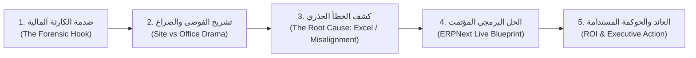
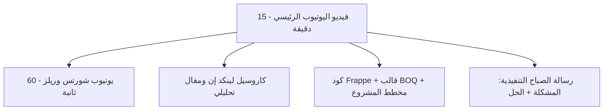

# NEXORA — PHASE 04 — CONTENT STRATEGY & EDITORIAL PILLARS
## المرحلة 04: استراتيجية المحتوى، الأعمدة التحريرية، وهندسة الانتشار

---

### 1. رقم المرحلة واسمها
* **المرحلة:** 04 (Phase 04)
* **الاسم:** استراتيجية المحتوى المؤسسي، تفكيك الأعمدة التحريرية، وهندسة الانتشار الفيروسي (Content Strategy & Editorial Pillars).

---

### 2. الهدف من المرحلة (Objective)
تأسيس "محرك المحتوى" المتكامل لـ **NEXORA** الذي يضمن:
1. تحويل المعرفة التقنية والهندسية والمحاسبية المعقدة إلى مواد مرئية ومقروءة ممتعة تشد الانتباه وتحقق ملايين المشاهدات.
2. برمجة صيغ المحتوى (Formats) لكل منصة وفقاً لطبيعة جمهورها وسلوك خوارزمياتها (YouTube, LinkedIn, Telegram, WhatsApp).
3. تحديد بنك المواضيع القياسي عبر الأعمدة الأربعة لضمان عدم نفاد الأفكار واستمرارية النشر بأعلى كفاءة.
4. هندسة خوارزميات الـ Retention ومعدلات النقر (CTR) وتحسين محركات البحث للشركات (B2B SEO).

---

### 3. نطاق العمل (Scope of Work)
* **الصيغ المرئية والمكتوبة:**
  * الفيديوهات الطويلة الوثائقية (12 - 20 دقيقة) على YouTube.
  * كبسولات الفيديو العمودي السريعة (30 - 60 ثانية) على Shorts, Reels, TikTok.
  * الكاروسيل التحليلي والمنشورات القيادية على LinkedIn.
  * الملفات والأكواد التطبيقية المساندة على Telegram.
  * الكبسولات التنفيذية الصوتية والمكتوبة اليومية على WhatsApp.
* **القطاعات المستهدفة بالدراسة والتحليل:** شركات المقاولات، التطوير العقاري، المكاتب الهندسية، شركات سلاسل الإمداد، المؤسسات المالية، والشركات التجارية الراغبة في أتمتة العمليات عبر ERPNext.

---

### 4. منهجية التحرير وهندسة السرد (Editorial Methodology)
نعتمد نموذج **"القوس الدرامي المؤسسي" (The Corporate Narrative Arc)** المبتكر من NEXORA:

---

### 5. النتائج التفصيلية (Detailed Findings & Pillars Breakdown)

#### أ. تفكيك الأعمدة التحريرية الأربعة بمواضيع محددة (The 4 Editorial Pillars)

##### العمود 1: تشريح الكوارث والتحقيقات المؤسسية (Enterprise Autopsy - 35% من المحتوى)
* **الهدف:** تفجير الفضول وجذب الرؤساء التنفيذيين والمدراء عبر تحليل انهيار أو تعثر مشاريع عملاقة بأدلة قطعية.
* **قائمة المواضيع المعيارية:**
  1. *كارثة المستخلصات:* كيف ابتلع بند خرسانة واحد 12 مليون دولار؟
  2. *أكبر فضيحة محاسبية في قطاع الإنشاءات:* كيف تختفي الدفعات المقدمة لمقاولي الباطن؟
  3. *فخ أوامر التغيير (Change Orders):* كيف تحول مشروع رابح بـ 50 مليون إلى خسارة بـ 15 مليون؟
  4. *سقوط المقاول التاريخي:* قصة تعثر شركة مقاولات عمرها 30 عاماً بسبب ملف إكسل مشترك!
  5. *المخزن الثقب الأسود:* كيف تبخر 400 طن من حديد التسليح دون أن يلاحظ أحد؟

##### العمود 2: ماستر كلاس الأنظمة والحلول عبر ERPNext (Technical Blueprint - 30% من المحتوى)
* **الهدف:** بناء المصداقية التقنية وتقديم الحل الجذري للمطورين ومدراء المشاريع والمحاسبين.
* **قائمة المواضيع المعيارية:**
  1. *بناء شجرة الحسابات الهندسية من الصفر:* ربط الـ Cost Centers بالمشاريع.
  2. *أتمتة مستخلصات مقاولي الباطن:* منع الصرف الزائد بكود Frappe Server Script.
  3. *من الـ BOQ إلى أمر الشراء:* تحويل المخطط الهندسي إلى طلب مواد مؤتمت بضغطة زر.
  4. *تطبيق الجوال لمهندس الموقع:* تسجيل الحضور، التوريدات، وإشعارات الإنجاز دون ورق.
  5. *الموازنات التقديرية الحية:* تنبيه الـ CFO عند وصول المشروع لـ 80% من التكلفة.

##### العمود 3: مناظرات ومقارنات "الصح والخطأ" (Right vs. Wrong Arena - 20% من المحتوى)
* **الهدف:** إثارة الجدل المهني والنقاشات الساخنة على لينكد إن ويوتيوب لمضاعفة التفاعل الفيروسي.
* **قائمة المواضيع المعيارية:**
  1. *مهندس الموقع ضد المدير المالي:* صراع صب الخرسانة العاجل ضد قيد الصرف النظامي.
  2. *ERPNext ضد SAP وOracle:* هل يستحق العملاق المغلق 500 ألف دولار سنوياً؟
  3. *الإكسل ضد الـ ERP:* مقارنة حية لسرعة اكتشاف العجز المالي في 60 ثانية.
  4. *البرمجة من الصفر ضد أطر العمل الجاهزة (Frappe):* لماذا تفشل البرمجة المخصصة داخلياً؟

##### العمود 4: كبسولات القيادة والذكاء المؤسسي (Executive Flash Briefs - 15% من المحتوى)
* **الهدف:** ترسيخ المرجعية الفكرية للـ C-Level عبر نصائح مكثفة تركز على الـ ROI والحوكمة.
* **قائمة المواضيع المعيارية:**
  1. *لوحة تحكم المليار دولار:* الـ 5 مؤشرات التي يجب أن يراها رئيس مجلس الإدارة صباح كل سبت.
  2. *حساب إنتاجية المهندس والمشرف بالدولار:* كيف تربط ساعات العمل بربحية المشروع؟
  3. *دليل الـ CEO لاختيار نظام الـ ERP:* 3 أسئلة تكشف لك هل تشتري حلاً أم كابوساً.

---

#### ب. مصفوفة صيغ المحتوى عبر المنصات الأربع (Cross-Platform Distribution Grid)

| المنصة | نوع وشكل المحتوى | الهدف الرئيسي | دعوة العمل (Call to Action - CTA) |
| :--- | :--- | :--- | :--- |
| **YouTube** | فيديو وثائقي سينمائي (1080p/4K) | بناء العمق المعرفي وجذب الاشتراكات والشهرة العالمية | "رابط تحميل الأكواد والقوالب مجاناً في التلجرام" |
| **LinkedIn** | كاروسيل من 6-8 شرائح + مقال تحليلي عميق | استهداف صناع القرار وتوليد عملاء استشارات B2B | "شارك برأيك في التعليقات: كيف تدير هذه الأزمة في شركتك؟" |
| **Telegram** | قوالب Excel/CSV، أكواد Python، ونقاشات فنية | تحويل المشاهدين العابرين إلى مجتمع موالٍ عالي التفاعل | "قم بتطبيق السكربت على بيئتك التجريبية وشاركنا النتائج" |
| **WhatsApp** | رسالة نصية مركزة (3 نقاط) + مقطع صوتي (1 دقيقة) | البقاء اليومي في ذهن الرؤساء التنفيذيين كل صباح | "شارك الرسالة مع فريقك المالي والهندسي لحماية المشروع" |

---

#### ج. استراتيجية الكلمات المفتاحية وتحسين محركات البحث للشركات (B2B SEO)

تم بناء استراتيجية الكلمات المفتاحية لاستهداف نية البحث (Search Intent) ذات القيمة المالية العالية:

1. **الكلمات المفتاحية للأنظمة والبرمجيات:**
   * `ERPNext شرح كامل`, `ERPNext Construction Module`, `Frappe Framework tutorial`, `أفضل نظام ERP للمقاولات`, `بديل ساب المفتوح المصدر`, `ERPNext vs Odoo`.
2. **الكلمات المفتاحية للهندسة وإدارة المشاريع:**
   * `حصر الكميات BOQ`, `أوامر التغيير Change Orders`, `مستخلصات مقاولي الباطن`, `إدارة تكاليف المشاريع الإنشائية`, `عقود الفيديك FIDIC`, `Project Cost Control`.
3. **الكلمات المفتاحية للمالية والحوكمة:**
   * `شجرة الحسابات لشركات المقاولات`, `التدفق النقدي Cash Flow`, `مراكز التكلفة Cost Centers`, `منع اختلاسات مواد البناء`, `Job Costing Accounting`.

---

### 6. القرارات والتوصيات الصادرة عن المرحلة 04

* **القرار 1:** تثبيت نسب الأعمدة التحريرية الأربعة (35% تشريح كوارث، 30% ماستر كلاس ERPNext، 20% مناظرات صح وخطأ، 15% كبسولات القيادة).
* **القرار 2:** الإلزام بتقديم "أصل رقمي قابل للتطبيق الفوري" (Digital Downloadable Asset) مع كل فيديو رئيسي (كود، قالب، نموذج إكسل) لتغذية قمع التحويل.
* **القرار 3:** اعتماد صيغة إعادة تدوير المحتوى (Content Repurposing) بحيث يتحول كل فيديو يوتيوب إلى 3 شورتس، كاروسيل لينكد إن، ملف تيليجرام، وكبسولة واتساب دون بذل جهد كتابة مضاعف.

---

### 7. النقاط التي تحتاج إلى اعتماد المالك (Gate 04 Sign-off)

1. **اعتماد محاور وتوزيع الأعمدة التحريرية الأربعة.**
2. **اعتماد مصفوفة صيغ المحتوى وتكامل المنصات (يوتيوب، لينكد إن، تلجرام، واتساب).**
3. **اعتماد استراتيجية الـ B2B SEO وقواعد إعادة تدوير المحتوى.**
4. **منح الإذن بالانتقال إلى: المرحلة 05 (التقويم التحريري لأول 90 يوماً - Editorial Calendar 90 Days).**

---

### 8. حالة المرحلة (Phase Status)
* **الحالة:** `مكتملة للمراجعة والاعتماد (Completed for Sign-off)`
* **المرحلة التالية فور الاعتماد:** الانتقال إلى المرحلة 05 وإعداد مستند:
  `NEXORA — PHASE 05 — 90-DAY EDITORIAL CALENDAR`

