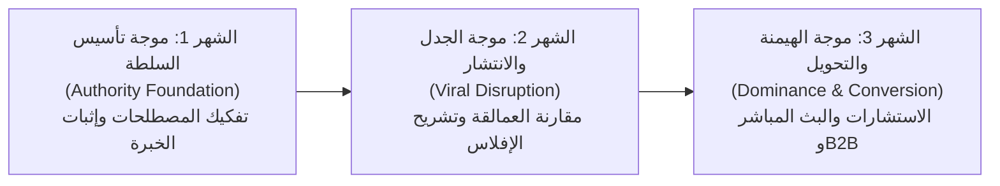

# NEXORA — PHASE 05 — 90-DAY EDITORIAL CALENDAR
## المرحلة 05: التقويم التحريري وجدولة النشر الشاملة لأول 90 يوماً

---

### 1. رقم المرحلة واسمها
* **المرحلة:** 05 (Phase 05)
* **الاسم:** التقويم التحريري، جدولة النشر متعددة المنصات، وخارطة طريق الـ 90 يوماً الأولى (90-Day Editorial Calendar & Publishing Cadence).

---

### 2. الهدف من المرحلة (Objective)
تأسيس خطة زمنية تشغيلية دقيقة وغير قابلة للعشوائية تغطي أول **12 أسبوعاً (3 أشهر متتالية)**، وتضمن:
1. توزيع النشر المتوازن بين الأعمدة التحريرية الأربعة المعتمدة في المرحلة 04.
2. تزامن متكامل يومياً بين منصات (YouTube, LinkedIn, Telegram, WhatsApp).
3. تحديد المواعيد والأيام المثالية للنشر وفق سلوك وتواجد الرؤساء التنفيذيين والمهندسين.
4. تجهيز الأصول الرقمية المرفقة لكل أسبوع (قوالب، أكواد، ومستندات) لتغذية قمع التحويل الاستشاري.

---

### 3. نطاق العمل (Scope of Work)
* **المدى الزمني:** 90 يوماً مقسمة إلى 3 موجات استراتيجية (كل شهر يمثل موجة).
* **حجم الإنتاج المجدول في الـ 90 يوماً:**
  * **12 فيديو وثائقي رئيسي طويل** على YouTube (حلقة كل سبت).
  * **36 فيديو شورتس وريلز** (3 مقاطع أسبوعياً: الإثنين، الأربعاء، الجمعة).
  * **24 منشور كاروسيل ومقال B2B** على LinkedIn (منشوران أسبوعياً: الأحد والثلاثاء).
  * **24 حزمة أصول برمجية وهندسية** على Telegram (حزمتان أسبوعياً).
  * **60 رسالة "كبسولة صباحية"** على WhatsApp (يومياً من الأحد إلى الخميس الساعة 8:00 صباحاً).

---

### 4. فلسفة الموجات الاستراتيجية الثلاث (The 3 Strategic Waves)

---

### 5. إيقاع وتوقيتات النشر الأسبوعية المثلى (Weekly Publishing Schedule)
بتوقيت مكة المكرمة (+3 GMT) بما يطابق ذروة تفاعل مجتمع الأعمال في الخليج والشرق الأوسط:

| اليوم | المنصة الأساسية | نوع المحتوى | التوقيت المستهدف | الجمهور المستهدف |
| :--- | :--- | :--- | :--- | :--- |
| **السبت** | **YouTube الرئيسي** | العرض الأول للحلقة الوثائقية الطويلة | **8:00 مساءً** | الـ C-Suite والمهندسون في عطلة نهاية الأسبوع |
| **الأحد** | **LinkedIn + WhatsApp** | كاروسيل تحليلي + كبسولة الصباح التنفيذية | **8:00 صباحاً** | المدراء التنفيذيون في بداية أسبوع العمل |
| **الإثنين** | **YouTube Shorts / Reels** | كبسولة 60 ثانية مقتطعة من حلقة السبت | **1:00 ظهراً** | استراحة الظهيرة للمهندسين والموظفين |
| **الثلاثاء** | **LinkedIn + Telegram** | منشور مناظرة "صح ضد خطأ" + كود Frappe | **10:00 صباحاً** | المطورون والمدراء الماليون |
| **الأربعاء** | **YouTube Shorts / Reels** | شورتس صدمة مالية "خطأ يكلف 50 ألف دولار" | **5:00 عصراً** | نهاية ساعات الدوام الرسمي |
| **الخميس** | **WhatsApp VIP + تلجرام** | ملخص الأسبوع التنفيذي + قالب جاهز للتحميل | **8:30 صباحاً** | تقفيل مهام الأسبوع في الشركات |
| **الجمعة** | **Shorts ترفيهي هندسي** | شورتس سريع حول غرائب الهندسة والـ ERP | **2:00 ظهراً** | التفاعل العائلي والترفيهي الهادف |

---

### 6. جدول الحلقات الطويلة والمنشورات للأشهر الثلاثة (Week-by-Week Breakdown)

#### الشهر الأول: موجة "تأسيس السلطة المعرفية" (Weeks 01 - 04)

| الأسبوع | كود الحلقة | عنوان الفيديو الوثائقي الرئيسي (YouTube) | العمود التحريري | الأصل الرقمي المرفق (Telegram/LinkedIn) |
| :---: | :---: | :--- | :--- | :--- |
| **W01** | **EP-01** | **كارثة المستخلصات:** كيف ابتلع بند خرسانة واحد 12 مليون دولار؟ | تشريح كوارث (35%) | كود Frappe Server Script لمنع تجاوز كمية الـ BOQ + قالب إكسل. |
| **W02** | **EP-02** | **جحيم الإكسل:** لماذا يخدعك تقرير الأرباح الشهري وأنت تخسر؟ | ماستر كلاس ERPNext (30%) | شجرة حسابات شركات المقاولات المعتمدة (COA Template) لـ ERPNext. |
| **W03** | **EP-03** | **مهندس الموقع ضد المدير المالي:** المناظرة الحقيقية وحسم النزاع | مناظرات الصح والخطأ (20%) | مسار عمل (Workflow Scheme) لاعتماد طلبات الشراء من الموقع بالموبايل. |
| **W04** | **EP-04** | **نزيف المخزن الإنشائي:** كيف يتبخر 15% من حديد التسليح والمواد؟ | تشريح كوارث (35%) | دورة حركة المخازن الافتراضية ومخازن الموقع (Material Issue Script). |

---

#### الشهر الثاني: موجة "الجدل والتحدي والانتشار الفيروسي" (Weeks 05 - 08)

| الأسبوع | كود الحلقة | عنوان الفيديو الوثائقي الرئيسي (YouTube) | العمود التحريري | الأصل الرقمي المرفق (Telegram/LinkedIn) |
| :---: | :---: | :--- | :--- | :--- |
| **W05** | **EP-05** | **الهروب من احتكار العمالقة:** كيف وفرنا 500,000$ باستبدال SAP بـ ERPNext؟ | مناظرات ومقارنات (20%) | دراسة جدوى مالية ومقارنة TCO (Total Cost of Ownership) قابلة للتعديل. |
| **W06** | **EP-06** | **فخ أوامر التغيير (Change Orders):** منجم ذهب للمقاول أم مقبرة للمالك؟ | تشريح كوارث (35%) | نموذج ملحق العقد المالي وأمر التغيير المؤتمت في موديول المشاريع. |
| **W07** | **EP-07** | **المطور التائه:** لماذا تفشل 80% من الأنظمة المبرمجة داخلياً من الصفر؟ | ماستر كلاس ERPNext (30%) | دليل Frappe Framework المعماري للمبرمجين وكيف تبني Custom App. |
| **W08** | **EP-08** | **الموارد البشرية ليست مسير رواتب:** كيف تحسب إنتاجية المهندس بالدولار؟ | كبسولات القيادة (15%) | موديول الـ Timesheets المربوط بتكلفة المشروع ومؤشرات الأداء (KPIs). |

---

#### الشهر الثالث: موجة "الهيمنة وتوليد عقود الاستشارات B2B" (Weeks 09 - 12)

| الأسبوع | كود الحلقة | عنوان الفيديو الوثائقي الرئيسي (YouTube) | العمود التحريري | الأصل الرقمي المرفق (Telegram/LinkedIn) |
| :---: | :---: | :--- | :--- | :--- |
| **W09** | **EP-09** | **لغة الأرقام الصامتة:** دمج الـ BIM مع الـ ERP (المستقبل يبدأ اليوم) | ماستر كلاس ERPNext (30%) | ورقة عمل معمارية ربط معرفات الـ 3D BIM بنظام التوريدات في ERPNext. |
| **W10** | **EP-10** | **أمن البيانات والسيادة الرقمية:** ماذا تفعل لو سُرقت قاعدة بياناتك الليلة؟ | كبسولات القيادة (15%) | دليل الـ Backup التلقائي المشفر، إدارة الصلاحيات، واستراتيجيات الحماية. |
| **W11** | **EP-11** | **بث مباشر استثنائي (تحدي 12 ساعة):** بناء نظام شركة مقاولات وعقارات كاملة على الهواء! | حدث فيروزي مباشر (Viral Event) | النسخة الاحتياطية الكاملة للموقع التجريبي (Database Fixture) مجاناً. |
| **W12** | **EP-12** | **لوحة تحكم المليار دولار:** كيف يرى الرئيس التنفيذي إمبراطوريته في شاشة واحدة؟ | كبسولات القيادة (15%) | لوحة قيادة تنفيذية (Executive Dashboard) حية مجهزة بروابط Power BI وFrappe Insights. |

---

### 7. مصفوفة الكبسولات اليومية للواتساب (Sample 2-Week Cadence)

* **الأحد (W01):** *"صباح الخير قادة الأعمال.. هل تعلم أن 98% من الميجا بروجكتس تتجاوز ميزانياتها وفق ماكنزي؟ السبب في الغالب ليس فساداً، بل غياب الرقابة اللحظية على الموقع."*
* **الإثنين (W01):** *"رسالة اليوم لمهندسي المشاريع: التوقيع على ورقة استلام خرسانة في الموقع دون ربطها بحساب الـ BOQ يعادل توقيع شيك على بياض من ميزانية الشركة!"*
* **الثلاثاء (W01):** *"للمدراء الماليين: قيد اليوم.. كيف تثبت حركة المواد من المخزن الرئيسي إلى مخزن الموقع دون أن تحسبها كمصروف مباشر قبل التركيب؟"*
* **الأربعاء (W01):** *"للمبرمجين ورواد الأعمال: كود من 5 أسطر في Frappe يوفر على الشركة 50 ألف دولار كل شهر.. رابطه متاح في التيليجرام."*
* **الخميس (W01):** *"كبسولة إغلاق الأسبوع للرؤساء التنفيذيين: 3 مؤشرات إذا لم تراها في تقرير الخميس، فأنت تدير شركتك بالعمى المالي."*

---

### 8. القرارات والتوصيات الصادرة عن المرحلة 05

* **القرار 1:** الالتزام الصارم بموعد نشر الحلقة الرئيسية **كل سبت الساعة 8:00 مساءً** لتأسيس عادة أسبوعية لدى جمهور الأعمال.
* **القرار 2:** اعتماد جدول النشر المشترك للموجات الثلاث لبناء الزخم المتدرج (السلطة ⬅ الجدل الفيروسي ⬅ استقطاب الاستشارات B2B).
* **القرار 3:** إطلاق البث المباشر الماراثوني في الأسبوع الـ 11 لتتويج الـ 90 يوماً الأولى وصناعة حدث تريند تاريخي في قطاع الـ ERP.

---

### 9. النقاط التي تحتاج إلى اعتماد المالك (Gate 05 Sign-off)

1. **اعتماد التقويم الزمني وإيقاع النشر الأسبوعي بتوقيت مكة المكرمة.**
2. **اعتماد عناوين ومحاور الـ 12 أسبوعاً وتوزيع الموجات الثلاث.**
3. **اعتماد خطة الأصول الرقمية المرفقة لكل أسبوع على تلجرام ولينكد إن.**
4. **منح الإذن بالانتقال إلى: المرحلة 06 (إنتاج حزمة الإطلاق التجريبية والسيناريوهات التفصيلية - Production of Pilot Flagship Batch).**

---

### 10. حالة المرحلة (Phase Status)
* **الحالة:** `مكتملة للمراجعة والاعتماد (Completed for Sign-off)`
* **المرحلة التالية فور الاعتماد:** الانتقال إلى المرحلة 06 وإعداد مستند:
  `NEXORA — PHASE 06 — PILOT PRODUCTION & VIDEO SCRIPTS BATCH`
