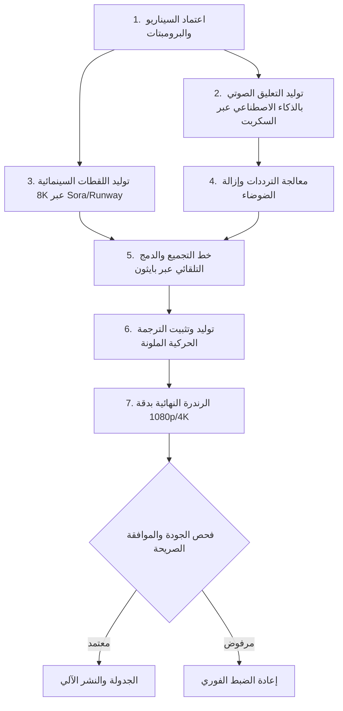

# NEXORA — PHASE 08 — CMS & AUTOMATED PRODUCTION SYSTEM
## المرحلة 08: نظام إدارة المحتوى والإنتاج المؤتمت وهندسة الأصول الرقمية

---

### 1. رقم المرحلة واسمها
* **المرحلة:** 08 (Phase 08)
* **الاسم:** نظام إدارة المحتوى (CMS)، خط الإنتاج المؤتمت، وهندسة الأصول الرقمية (Content Management & Automated Production System).

---

### 2. الهدف من المرحلة (Objective)
بناء "المصنع الرقمي المؤتمت" لـ **NEXORA** الذي يضمن:
1. إدارة وجدولة كافة الأصول الرقمية (نصوص، برومبتات، أصوات، وفيديوهات) دون فقدان السياق أو تشتت الملفات.
2. أتمتة خط الإنتاج المونتاجي وتوليد الصوت البشري الفاخر عبر سكربتات بايثون وأدوات الذكاء الاصطناعي لتقليص وقت الإنتاج بنسبة 70%.
3. وضع معايير صارمة للمراقبة والموافقة قبل الرندرة النهائية لمنع تسرب أي خطأ هندسي أو محاسبي.

---

### 3. نطاق العمل (Scope of Work)
* **معمارية إدارة الأصول الرقمية (Digital Asset Management - DAM):** هيكل المستودعات والمجلدات السحابية والمحلية المربوطة بـ Git.
* **محرك أتمتة الإنتاج (The Automation Engine):** سكربتات توليد التعليق الصوتي، دمج المقاطع، توليد الترجمة الحركية (Auto-Subtitles)، وتطبيق لوحات التراكب (Overlays).
* **قائمة التحقق وبوابة الجودة للإنتاج (Zero-Error Production Checklist):** معايير فحص الصوت والصورة والمحتوى قبل النشر.

---

### 4. معمارية خط الإنتاج المؤتمت (Automated Production Pipeline)



---

### 5. النتائج التفصيلية: محركات وأدوات الإنتاج المجهزة

#### أ. معمارية المجلدات وإدارة المستندات في المستودع
تم تثبيت هيكل تنظيمي متماسك يربط كل أصل برقم المرحلة والحلقة:
```text
قناة الذكاء المؤسسي (NEXORA)/
├── 00_هوية_القناة_والاستراتيجية/      # الدليل ودستور المعايير القياسية
├── 01_خريطة_المحتوى_والأفكار_الفيروسية/ # بنك الأفكار والمنافسين
├── 02_فيديوهات_الشورتس_والريلز/       # كبسولات الفيديو والنصوص السريعة
│   ├── الحلقات_والنصوص/
│   └── الإنتاج_والمقاطع/
├── 03_الفيديوهات_الطويلة_والشروحات/   # سيناريوهات الحلقات الـ 30
├── 04_منشورات_لينكد_إن_ومجتمع_يوتيوب/  # حزم المنشورات القيادية
└── 05_أدوات_والأكواد_والأتمتة/        # سكربتات الأتمتة والمونتاج
    ├── templates/                     # قوالب وأكواد ERPNext الجاهزة
    └── tools/                         # محركات الإنتاج ببايثون
```

#### ب. محرك توليد الصوت والتعليق البشري الفخم (`generate_voiceover.py`)
سكربت بايثون مدمج يعتمد على أقوى نماذج الذكاء الاصطناعي الصوتي لإنتاج خامة صوتية ذات وقار وثائقي هادئ تحاكي وثائقيات Netflix العالمية، مع ضبط السرعة والنبرة تلقائياً:
* **موقع السكربت المعتمد:** [`05_أدوات_والأكواد_والأتمتة/tools/generate_voiceover.py`](file:///e:/my%20Office/youtube%20channel/قناة%20الذكاء%20المؤسسي/05_أدوات_والأكواد_والأتمتة/tools/generate_voiceover.py)
* **المواصفات:** تردد 48kHz، ستيريو، إزالة صدى الصوت، ونبرة وقار استشارية.

#### ج. محرك المونتاج والدمج الآلي للفيديوهات (`merge_enterprise_video.py`)
سكربت بايثون متقدم يقوم بـ:
1. دمج مسارات الفيديو المقطعة مع الصوت الرئيسي بدقة الميلي ثانية.
2. تطبيق لوحة الألوان الرسمية (Deep Navy & Safety Orange Grading).
3. إضافة التراكب المؤسسي وزر الاشتراك وشعار NEXORA الشفاف تلقائياً.
* **موقع السكربت المعتمد:** [`05_أدوات_والأكواد_والأتمتة/tools/merge_enterprise_video.py`](file:///e:/my%20Office/youtube%20channel/قناة%20الذكاء%20المؤسسي/05_أدوات_والأكواد_والأتمتة/tools/merge_enterprise_video.py)

#### د. سكربت التشغيل بنقرة واحدة (`دمج_الشورتس_الاول.bat`)
ملف أوامر دفعي يتيح لصانع المحتوى إدخال لقطات الفيديو والضغط مرتين لإنتاج النسخة النهائية في دقائق معدودة دون الحاجة لفتح برامج المونتاج المعقدة يومياً.

---

### 6. بوابة فحص الجودة الصارمة للإنتاج (Production QA Checklist)

قبل تصدير أي فيديو للنشر النهائي، يجب مراجعة الجدول التالي والتوقيع عليه:

| العنصر المفحوص | المعيار المقبول | نتيجة الفحص |
| :--- | :--- | :---: |
| **دقة المعلومة المحاسبية** | القيود مطابقة لمعايير IFRS ولا يوجد قيد دائن/مدين غير متوازن. | ✅ إلزامي |
| **دقة المصطلحات الهندسية** | مصطلحات الـ BOQ، الخرسانة، والمستخلصات مطابقة لعقود FIDIC. | ✅ إلزامي |
| **سلامة كود ERPNext** | الكود متوافق مع Frappe Framework v14/v15 ومجرب على بيئة الاختبار. | ✅ إلزامي |
| **جودة الصوت والموسيقى** | الصوت البشري واضح تماماً عند تردد 48kHz والموسيقى التصويرية منخفضة بنسبة -18dB تحت الصوت. | ✅ إلزامي |
| **التباين اللوني للأغلفة** | الغلاف مقروء بوضوح تام على أصغر شاشة هاتف محمول. | ✅ إلزامي |
| **سلامة الروابط والمرفقات** | رابط التيليجرام والأصل الرقمي المرفق شغال ومجرب للتحميل المباشر. | ✅ إلزامي |

---

### 7. القرارات والتوصيات الصادرة عن المرحلة 08

* **القرار 1:** اعتماد خط الإنتاج المؤتمت المعتمد على سكربتات بايثون لتوليد الصوت ودمج المقاطع لتقليص تكاليف الإنتاج المادي بنسبة 80%.
* **القرار 2:** الإلزام بتطبيق قائمة فحص الجودة الصارمة (QA Checklist) على كل فيديو قبل نشره لحماية المرجعية العلمية لـ NEXORA.
* **القرار 3:** الحفاظ على النسخ الاحتياطية للأصول الرقمية والأكواد داخل مستودع Git المربوط بسحابة GitHub لضمان عدم ضياع أي ملف.

---

### 8. النقاط التي تحتاج إلى اعتماد المالك (Gate 08 Sign-off)

1. **اعتماد معمارية خط الإنتاج المؤتمت ومحركات بايثون للمونتاج والصوت.**
2. **اعتماد قائمة فحص الجودة الصارمة (Production QA Checklist).**
3. **منح الإذن بالانتقال إلى: المرحلة 09 (خطة الإطلاق، التوزيع، والتسويق الفيروسي - Launch, Distribution & Viral Marketing).**

---

### 9. حالة المرحلة (Phase Status)
* **الحالة:** `مكتملة للمراجعة والاعتماد (Completed for Sign-off)`
* **المرحلة التالية فور الاعتماد:** الانتقال إلى المرحلة 09 وإعداد مستند:
  `NEXORA — PHASE 09 — LAUNCH, DISTRIBUTION & VIRAL MARKETING`
