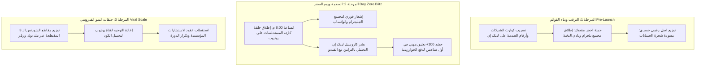
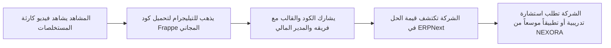

# NEXORA — PHASE 09 — LAUNCH, DISTRIBUTION & VIRAL MARKETING
## المرحلة 09: خطة الإطلاق الاستراتيجي، التوزيع متعدد القنوات، وهندسة الانتشار الفيروسي

---

### 1. رقم المرحلة واسمها
* **المرحلة:** 09 (Phase 09)
* **الاسم:** استراتيجية الإطلاق الكبرى (Zero-Day Launch)، التوزيع متعدد القنوات، وهندسة الانتشار الفيروسي للشركات (Launch, Distribution & Viral Growth Engine).

---

### 2. الهدف من المرحلة (Objective)
ضمان عدم نزول محتوى **NEXORA** في فراغ، وتحقيق انفجار أولي في المشاهدات والوصول إلى الفئات المستهدفة عبر:
1. بناء زخم استباقي (Pre-Launch Hype) يجمع قادة الشركات والمهندسين قبل إطلاق أول حلقة.
2. اختراق خوارزميات YouTube وLinkedIn في أول 120 دقيقة من النشر لتحفيز الانتشار التلقائي (Algorithmic Velocity).
3. تفعيل شبكات التوزيع والشراكات مع مجتمعات الأعمال والمطورين (Frappe Community & Construction Forums).
4. تحويل كل مشاهد إلى مروّج للمحتوى عبر حلقات النمو الفيروسي المؤسسية (B2B Viral Loops).

---

### 3. نطاق العمل (Scope of Work)
* **نموذج صاروخ الإطلاق ثلاثي المراحل (The 3-Stage Rocket Model):**
  * **المرحلة التمهيدية (Pre-Launch - 14 يوماً قبل الإطلاق):** بناء الترقب وقوائم الانتظار.
  * **يوم الانطلاق الخاطف (Day Zero Blitz):** الهجوم المنسق على كافة المنصات في وقت واحد.
  * **مرحلة التغذية الراجعة والنمو المتسارع (Post-Launch Scale - أول 60 يوماً):** إعادة التوزيع، البث المباشر، وتوليد العملاء.

---

### 4. معمارية نموذج صاروخ الإطلاق (The 3-Stage Rocket Launch Model)

---

### 5. النتائج التفصيلية: خطط التوزيع والانتشار

#### أ. خطة الترقب المسبق (Pre-Launch Teaser Campaign - 14 يوماً)
1. **منشورات الغموض الصادمة (The Mystery Posts على LinkedIn):**
   * نشر قصاصات وثائقية مجهولة المصدر لأرقام خسائر شركات الإنشاءات مع تساؤل: *"لماذا تخسر شركاتنا الملايين وهي تظن أنها تربح؟ الإجابة في 2026-11-XX"*.
2. **إطلاق الرابط السري لقناة Telegram:**
   * حصر الانضمام لـ "أول 500 قيادي ومطور فقط" للحصول على النسخة الحصرية من كود حوكمة الـ BOQ لـ ERPNext، مما يخلق حالة من الندرة والرغبة في الانضمام (Scarcity & FOMO).

#### ب. استراتيجية الساعات الأولى ويوم الإطلاق (Day Zero Blitz Engine)
الخوارزميات في YouTube وLinkedIn تقرر مصير الفيديو بناءً على أداء **أول ساعتين (Velocity & Retention)**:
* **التوقيت:** السبت الساعة **8:00 مساءً** بتوقيت مكة المكرمة.
* **التنسيق المتزامن:**
  1. يُنشر الفيديو الرئيسي على YouTube بجودة 4K مع تفعيل ميزة العرض الأول (Premiere) لجمع الجمهور في غرفة محادثة حية.
  2. يُرسل إشعار مباشر عبر تيليجرام وواتساب مع رابط الفيديو وسؤال نقاشي محدد.
  3. يُنشر كاروسيل لينكد إن في نفس اللحظة برابط في التعليق الأول لدفع الـ Dwell Time.
  4. الرد على أول 50 تعليقاً في أول ساعة بروية وعمق لإشعال خوارزمية النقاش.

#### ج. حلقات النمو الفيروسي المؤسسي (B2B Viral Loops)

1. **الـ Lead Magnet الذي لا يقاوم:** الكود البرمجي وقالب الـ BOQ لا يُمنحان إلا لمن ينضم للمجتمع؛ مما يحول كل مشاهد عابر إلى متابع دائم.
2. **مبدأ "أخبر رئيسك التنفيذي" (Tell Your Boss Hook):**
   * تضمين عبارة واضحة في نهاية كل فيديو: *"أرسل هذا الفيديو لمديرك التنفيذي ومديرك المالي.. قد تنقذ شركتك من خسارة الملايين غداً"*. الموظفون والمهندسون يشاركون الفيديو ليثبتوا لمدراءهم أنهم يفهمون في مصلحة الشركة.

#### د. استراتيجية الاختراق عبر مجتمعات المصادر المفتوحة (Frappe / ERPNext Ecosystem)
* نشر دراسات الحالة الهندسية والحلول في **منتدى Frappe الرسمي (discuss.frappe.io)** الذي يضم أكثر من 50,000 مطور وخبير ERP عالمياً.
* رفع الأكواد المفتوحة المصدر باسم `nexora-construction-suite` على GitHub لجلب حركة زيارات دولية من المطورين.

---

### 6. ميزانية وتكتيكات الترويج المدفوع الأولي (Zero to Low-Budget Launch)
لا نعتمد على حرق الأموال في إعلانات عشوائية، بل نعتمد على **"الإعلانات الجراحية فائقة الاستهداف" (Hyper-Targeted B2B Ads)**:
* **ميزانية تجريبية أولية:** 300 - 500 دولار فقط.
* **المنصة:** LinkedIn Sponsored Content مخصصة حصراً لـ:
  * المسميات الوظيفية: *(CEO, CFO, Managing Director, Project Director, Construction Manager)*.
  * في دول: *(السعودية، الإمارات، قطر، ومصر)*.
  * نوع المحتوى الممول: **كاروسيل تشريح الكوارث المالية**؛ لأن تكلفة النقرة مقابل جودة العميل (High Ticket Client) تعتبر الأفضل عالمياً.

---

### 7. القرارات والتوصيات الصادرة عن المرحلة 09

* **القرار 1:** حظر النشر العشوائي المنفرد؛ كل عملية إطلاق يجب أن تتبع بروتوكول الـ Day Zero Blitz بالتزامن التام عبر المنصات الأربع.
* **القرار 2:** اعتماد التوزيع العضوي الفيروسي المبني على قوة الأصول المجانية (الأكواد والقوالب) قبل التفكير في الحملات الإعلانية الكبرى.
* **القرار 3:** استغلال مجتمع Frappe وERPNext العالمي كمنصة انطلاق لاكتساب المصداقية التقنية الدولية.

---

### 8. النقاط التي تحتاج إلى اعتماد المالك (Gate 09 Sign-off)

1. **اعتماد نموذج صاروخ الإطلاق ثلاثي المراحل (Pre-Launch, Day Zero, Viral Scale).**
2. **اعتماد استراتيجية التزامن وساعات النشر الأولى (Day Zero Blitz).**
3. **اعتماد قمع التحويل الفيروسي وتكتيكات استهداف الـ C-Level.**
4. **منح الإذن بالانتقال إلى: المرحلة 10 والأخيرة (لوحة مؤشرات الأداء وخطة التوسع والتطوير - KPI Dashboard & Scaling Roadmap).**

---

### 9. حالة المرحلة (Phase Status)
* **الحالة:** `مكتملة للمراجعة والاعتماد (Completed for Sign-off)`
* **المرحلة التالية فور الاعتماد:** الانتقال إلى المرحلة 10 وإعداد مستند:
  `NEXORA — PHASE 10 — KPI DASHBOARD & SCALING ROADMAP`
