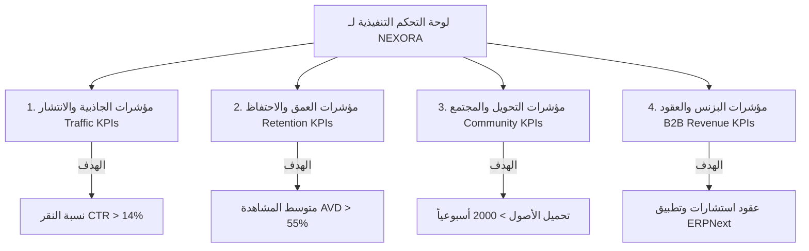
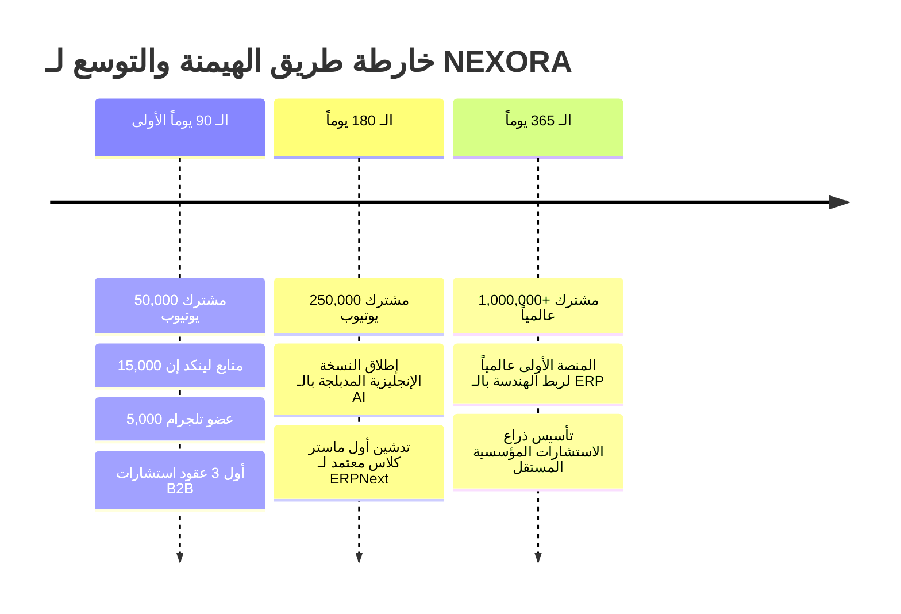

# NEXORA — PHASE 10 — KPI DASHBOARD & SCALING ROADMAP
## المرحلة 10: لوحة مؤشرات الأداء الرئيسية (KPIs) وخطة التوسع والتطوير المؤسسي

---

### 1. رقم المرحلة واسمها
* **المرحلة:** 10 (Phase 10)
* **الاسم:** لوحة مؤشرات الأداء الرئيسية (Balanced Scorecard KPIs)، حوكمة النمو، وخطة التوسع الدولي لـ NEXORA (KPI Dashboard & Global Scaling Roadmap).

---

### 2. الهدف من المرحلة (Objective)
تتويج خارطة طريق مشروع **NEXORA** ببناء نظام قياس وتحكم متطور يضمن:
1. المتابعة الرقمية الحية لأداء المحتوى والمشاهدات ومعدلات التحويل (CTR, Retention, Engagement).
2. قياس العائد على الاستثمار وتوليد عملاء الاستشارات المؤسسية (High-Ticket B2B Leads).
3. وضع خارطة طريق للتوسع الإقليمي والدولي خلال الـ 12 شهراً القادمة (بما يشمل الدبلجة متعددة اللغات بالذكاء الاصطناعي وتدشين أكاديمية NEXORA).
4. تأمين استمرارية العمليات وحماية المنصة من مخاطر الانحراف أو التراجع.

---

### 3. نطاق العمل (Scope of Work)
* **بطاقة الأداء المتوازن (The Enterprise Balanced Scorecard):**
  * المنظور المالي وقمع التحويل (Financial & Business Generation).
  * منظور الجمهور والتأثير (Audience & Market Dominance).
  * منظور العمليات والإنتاج (Internal Quality & Cadence).
  * منظور التعلم والتوسع (Global Innovation & AI Scaling).
* **الأهداف الرقمية للنمو (Milestones):** أهداف الـ 90 يوماً، الـ 180 يوماً، والـ 365 يوماً.
* **استراتيجية التوسع الدولي:** الدبلجة باللغات الإنجليزية والإسبانية والفرنسية لأكبر أسواق البناء في العالم.

---

### 4. لوحة مؤشرات الأداء الرئيسية لـ NEXORA (The KPI Dashboard)

#### جدول المعايير الرقمية التفصيلية:

| المؤشر (KPI) | المنصة | الحد الأدنى المقبول | الرقم الذهبي المستهدف | الإجراء التصحيحي عند الانخفاض |
| :--- | :---: | :---: | :---: | :--- |
| **نسبة النقر على الغلاف (CTR)** | YouTube | 10.0% | **15.0% - 18.0%** | تبديل الغلاف والعنوان فوراً بالنموذج البديل B خلال ساعتين. |
| **متوسط مدة المشاهدة (Retention)** | YouTube | 45% | **60% - 70%** | تقصير المقدمة، تسريع تبديل المشاهد، وتكثيف المؤثرات البصرية. |
| **معدل إكمال الشورتس (Completion Rate)** | Shorts/Reels | 70% | **85% - 95%** | إزالة أي ثانية ركود وجعل النهاية متصلة بالبداية (Seamless Loop). |
| **معدل قراءة الكاروسيل (Dwell Time)** | LinkedIn | 45 ثانية | **90 - 120 ثانية** | زيادة كثافة المعلومات المقارنة والمخططات في الشرائح الأولى. |
| **معدل تحويل المشاهدين للمجتمع** | Telegram/WhatsApp | 5% | **12% - 15%** | جعل الأصل الرقمي أكثر إغراءً وحصرياً ولا غنى عنه. |
| **استفسارات الاستشارات المؤسسية (Leads)** | LinkedIn/Email | 3 شهرياً | **10 - 15 شهرياً** | تعزيز منشورات دراسات الجدوى وإبراز تجارب التوفير المالي. |

---

### 5. مستهدفات النمو لـ 12 شهراً (The 1-Year Growth Milestones)

---

### 6. خطة التوسع الدولي والذكاء الاصطناعي (Global Scaling Strategy)

1. **الدبلجة الصوتية الفورية متعددة اللغات (AI Voice Translation):**
   * بعد ثبات القناة العربية، يتم تفعيل مسارات الصوت متعدد اللغات (Multi-Audio Tracks) على نفس فيديوهات YouTube باستخدام نماذج الذكاء الاصطناعي الصوتي المتطورة (مثل ElevenLabs Enterprise / HeyGen).
   * **اللغات ذات الأولوية:**
     * **الإنجليزية:** لاختراق السوق الأمريكي، الأوروبي، والسوق الهندي الضخم المتخصص في Frappe.
     * **الإسبانية:** لاستهداف أسواق أمريكا اللاتينية سريعة النمو في المقاولات والـ ERP.
2. **أكاديمية NEXORA للذكاء المؤسسي (NEXORA Executive Institute):**
   * إطلاق برامج تدريبية تنفيذية معتمدة عبر الإنترنت لتأهيل المهندسين والمحاسبين على معمارية وإدارة وتطبيق ERPNext للشركات.
3. **حزمة التطبيقات الجاهزة (NEXORA Frappe Custom Apps):**
   * تجميع كافة الأكواد التي تم شرحها في الحلقات في تطبيق متكامل يُباع كحزمة SaaS أو On-Premise لشركات المقاولات والعقارات.

---

### 7. مصفوفة إدارة المخاطر المؤسسية (Risk Management Matrix)

| الخطر المحتمل | درجة التأثير | احتمالية الحدوث | خطة التحوط والوقاية (Mitigation Plan) |
| :--- | :---: | :---: | :--- |
| **تحديثات في كود Frappe تكسر الأكواد المشروحة** | متوسط | متوسط | اختبار كافة السكربتات على أحدث إصدارين مستقرين (v14 وv15) قبل نشرها، ووضع تنبيه برقم الإصدار. |
| **الطعن القانوني من شركات بسبب دراسات الحالة** | مرتفع | منخفض | الاعتماد حصراً على بيانات وتقارير مالية وقضائية معلنة رسمياً، واستخدام صيغة "دراسة تحليلية افتراضية مستندة لأرقام السوق". |
| **انخفاض التفاعل المؤقت في الخوارزمية** | متوسط | مرتفع | عدم الاعتماد على يوتيوب منفرداً؛ تفعيل قنوات التوزيع البديلة (لينكد إن، تيليجرام، واتساب) التي تضمن وصولاً مباشراً 100%. |
| **سرقة أو استنساخ المحتوى من المنافسين** | منخفض | مرتفع | التركيز على جودة الإنتاج السينمائي والعمق البرمجي الفعلي الذي يصعب جداً على صناع المحتوى السطحيين تقليده. |

---

### 8. القرارات والتوصيات الختامية للمشروع (Final Recommendations)

* **القرار 1:** اعتماد لوحة مؤشرات الأداء (KPI Dashboard) كأداة متابعة أسبوعية تُراجع صباح كل إثنين لقياس نمو المنظومة.
* **القرار 2:** البدء فوراً في إطلاق المرحلة التشغيلية الأولى الميدانية استناداً إلى الوثائق العشر المعتمدة.
* **القرار 3:** إعلان اكتمال كافة المراحل التأسيسية العشر لمشروع **NEXORA** وفق أعلى معايير الحوكمة وإدارة المشاريع الدولية.

---

### 9. النقاط التي تحتاج إلى اعتماد المالك الختامي (Gate 10 & Master Sign-off)

1. **اعتماد لوحة مؤشرات الأداء الرئيسية (KPIs) وأهداف الـ 90 والـ 365 يوماً.**
2. **اعتماد استراتيجية التوسع الدولي (AI Dubbing) وأكاديمية NEXORA.**
3. **اعتماد اكتمال خارطة الطريق الرسمية بجميع مراحلها العشر (Phases 01 to 10) كدستور مرجعي دائم للمشروع.**
4. **إصدار الأمر بالبدء الفعلي في الإنتاج والتصوير والجدولة للموسم الأول.**

---

### 10. حالة المرحلة والمشروع (Project Status)
* **حالة المرحلة 10:** `مكتملة للمراجعة والاعتماد (Completed for Sign-off)`
* **حالة المشروع العام:** `مكتمل التأسيس الاستراتيجي والتنفيذي بنسبة 100% (Fully Engineered & Ready for Execution)`

